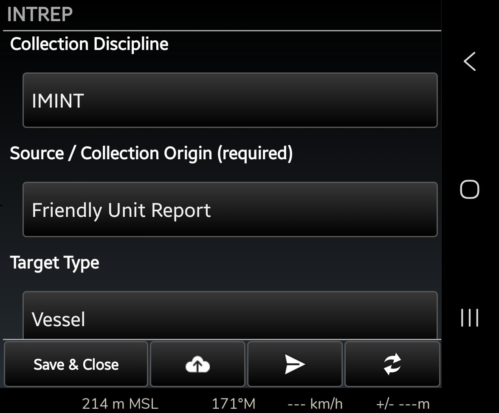
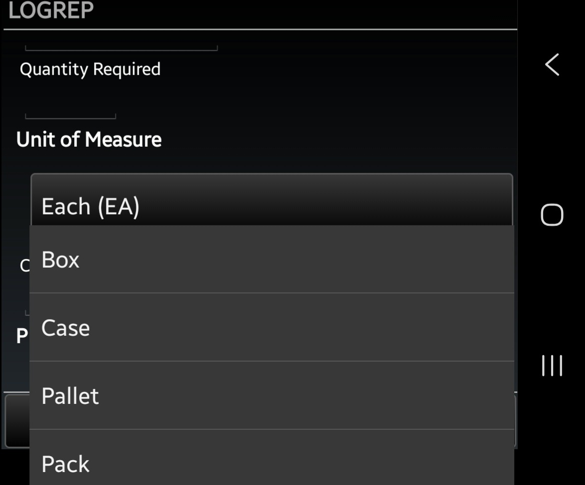
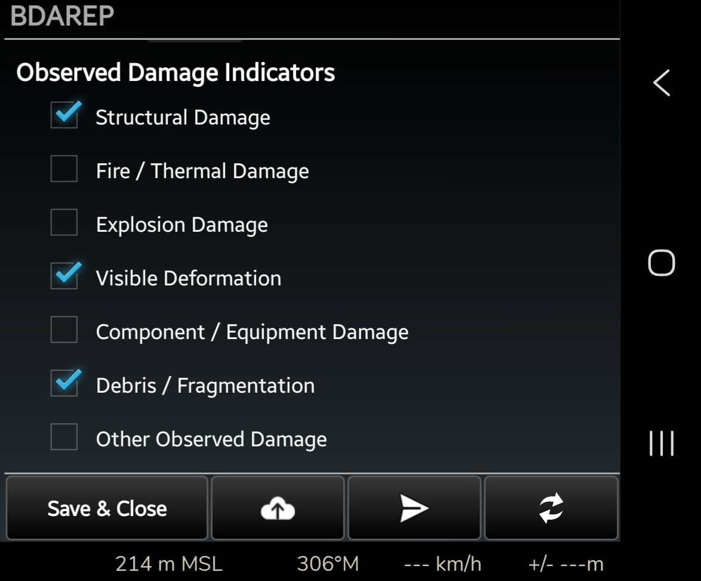
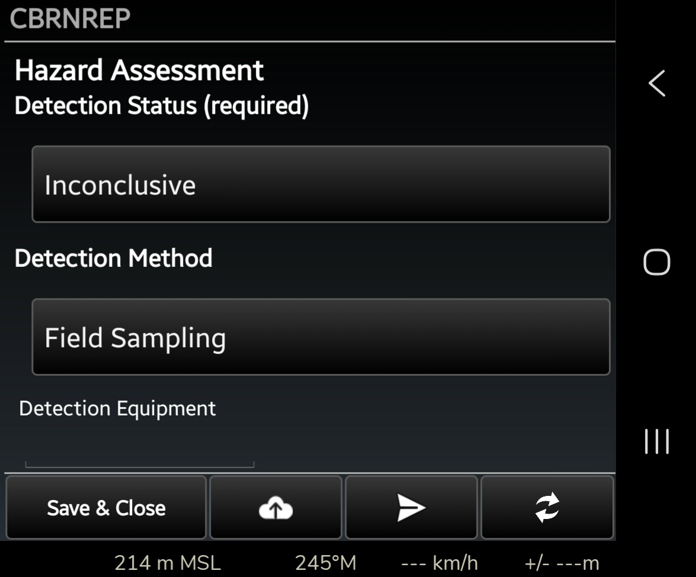

# ATAK Reports Templates

A collection of XML-based operational reporting templates for [ATAK](https://tak.gov), covering established reporting formats and purpose-built templates for tactical, intelligence, logistics, communications, incident response, and other operational requirements.

## Included Templates

| Template | Description |
| :--- | :--- |
| **SITREP** | Situation report covering operational status assessment, unit readiness, and mission progress. |
| **SALUTE** | Standard report for tactical field observations (Size, Activity, Location, Unit, Time, Equipment). |
| **INTREP** | Intelligence report for documenting observed activities, target characteristics, collection information, and analytical assessments, including source reliability and information credibility ratings (Admiralty Code). |
| **LINKREP** | Report template for logging tactical data link (TDL) status, network connectivity, node health, transport mediums, signal quality, and operational disruptions. |
| **LOGREP** | Logistics report covering personnel strength and availability, supply status, equipment readiness, and resupply requirements. |
| **UXO / IED** | Explosive hazard reporting template based on the 9-Line reporting format. |
| **TALON** | Structured C-UAS reporting template for documenting and classifying unmanned aircraft system (UAS) observations, including platform and propulsion types, observed activity, location, orientation, acoustic signatures, group formations, control links, guidance and navigation characteristics, estimated altitude, payload assessments, and visual characteristics. |
| **COMREP** | RF observation report for documenting observed frequencies, signal strength, communications types, direction of arrival, and interference conditions, including suspected or confirmed jamming. |
| **METHANE** | Major incident report for emergency triage, scene hazard identification, access routing, and Mass Casualty (MASCAL) counts. |
| **CBRNREP** | CBRN incident reporting, including hazard detection, agent identification confidence, contamination assessment, personnel exposure and protective measures. |
| **CONTACTREP** | Template for reporting enemy or threat contacts, including contact location, target type and strength, observed activity, actions taken by own forces, and contact outcome. |
| **BDAREP** | Battle damage assessment, including physical damage, functional status, affected capabilities, collateral effects and assessment confidence. |
| **INFRAREP** | Infrastructure status reporting, including operational condition, utility availability, accessibility, safety hazards, capacity and support requirements. |
| **ROUTEREP** | Route assessment covering route condition, accessibility, trafficability, movement restrictions, obstacles, and environmental hazards. |

## Key Features

- **Established reporting formats:** XML implementations of established reporting formats and conventions, including `SITREP`, `SALUTE`, `INTREP`, `LOGREP`, `METHANE`, and `UXO/IED` (9-line), with appropriate adaptations for ATAK.
- **Purpose-built templates:** Dedicated reporting structures for tactical data link status (`LINKREP`), counter-UAS observations (`TALON`), RF communications observations (`COMREP`), CBRN incidents (`CBRNREP`), contact reporting (`CONTACTREP`), battle damage assessment (`BDAREP`), infrastructure status (`INFRAREP`), and route assessment (`ROUTEREP`).
- **Operational Adaptability:** Reporting structures designed to accommodate different operational environments, evolving technologies, and situational awareness requirements.
- **Multi-Select Fields:** Checkbox-based selections for recording multiple observations, hazards, conditions, and requirements where applicable.
- **Geospatial Integration:** Utilizes ATAK-native `geometry` and `rangeBearing` field types for location selection and map-derived directional observations.
- **Configurable XML Templates:** Lightweight XML-based report definitions that can be adapted to different operational reporting requirements.

## Screenshots

Examples of the reporting templates running in ATAK `5.8.0`.

| INTREP — Intelligence Report | LOGREP — Logistics Report |
| :---: | :---: |
|  |  |
| Structured reporting and collection information | Custom measurement units |

| BDAREP — Battle Damage Assessment | CBRNREP — CBRN Incident Report |
| :---: | :---: |
|  |  |
| Multi-select damage indicators | CBRN hazard assessment |

## Installation

### Manual Installation

These templates are designed for use with the ATAK `Reports` plugin.

1. Ensure the Reports plugin is installed and enabled.
2. Copy the `.xml` template files to:

```text
/sdcard/atak/tools/reports/templates/custom/
```

3. Create the `custom` directory if it does not exist.
4. Open the Reports plugin and select the desired template.

Installation paths may vary depending on the ATAK distribution and version.

## Building Custom Templates

The repository includes [`CUSTOM.xml`](examples/CUSTOM.xml), a reference template demonstrating the XML field types and configurations used in the included reports.

The example covers:

- **Text and input fields:** String, numeric, time and date-time inputs.
- **Required and optional fields:** Field and section configuration.
- **Nested Sections:** Group related fields into nested sections to organise report structure.
- **Selection fields:** Dropdown lists, radio buttons and multi-select checkboxes.
- **Geospatial fields:** Location geometry, range and bearing, and route selection.
- **Measurement fields:** Numeric inputs with configurable measurement units.
- **Formula fields:** Example formula field configuration.

Use this template as a starting point when creating or adapting reporting templates. Modify the report metadata, section structure, field definitions and identifiers to suit your reporting requirements.

Custom templates should be tested in the intended ATAK environment to verify field rendering and functionality.

## Usage

1. Open ATAK.
2. Launch the Reports plugin.
3. Select the desired reporting template.
4. Complete the relevant fields.
5. Submit or share the report through the available ATAK reporting workflow.

## Testing and Compatibility

All included templates have been loaded and tested in ATAK `5.8.0`.

Testing includes:
- Template loading and display.
- Field rendering and interaction.
- Dropdown and multi-select functionality.
- Geospatial field selection and map interaction.
- Numeric inputs and measurement units, where applicable.
- Report submission.

XML well-formedness checks alone do not establish runtime compatibility.

## Contributing

1. Fork the repository.
2. Create a feature branch (`git checkout -b feature/new-template`).
3. Ensure XML files are well-formed and special characters are properly escaped.
4. Test changes in the intended ATAK environment.
5. Submit a Pull Request.

## License

Distributed under the [MIT License](LICENSE).
