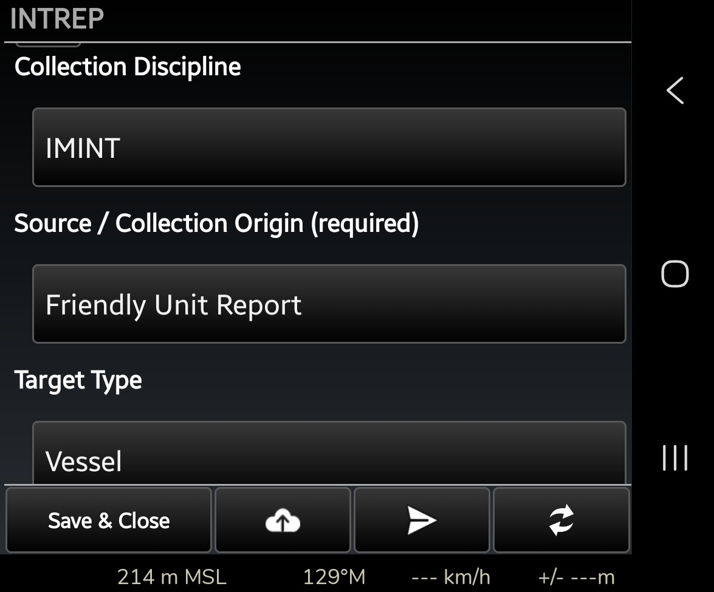
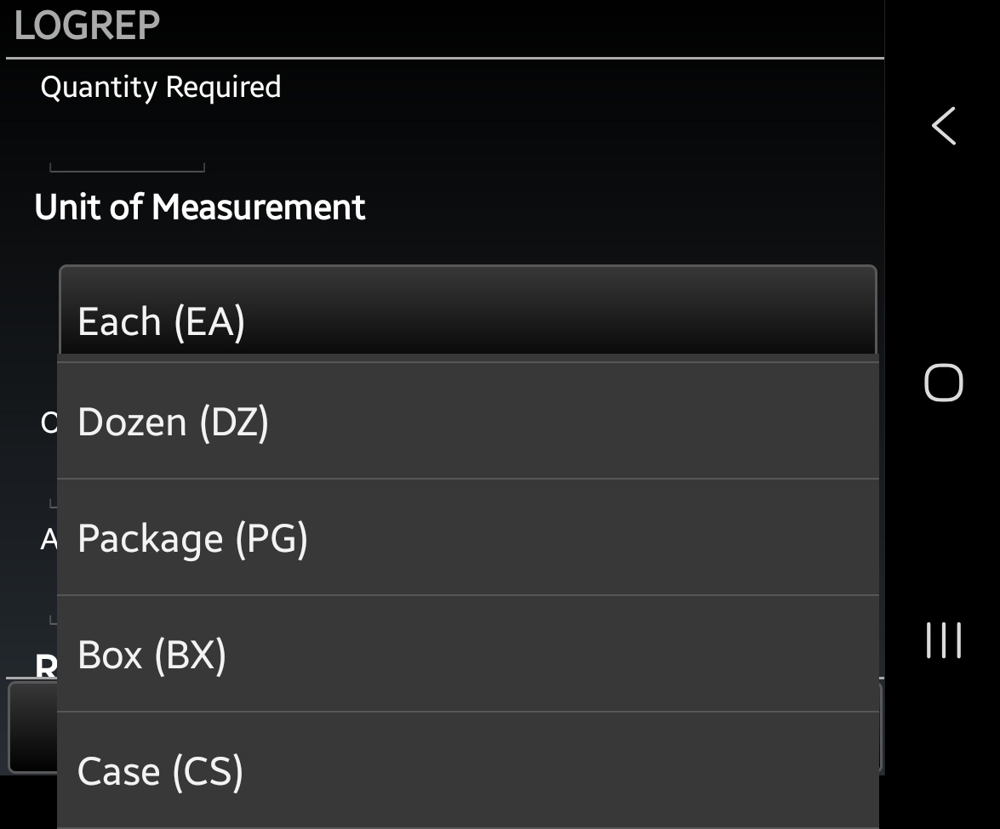
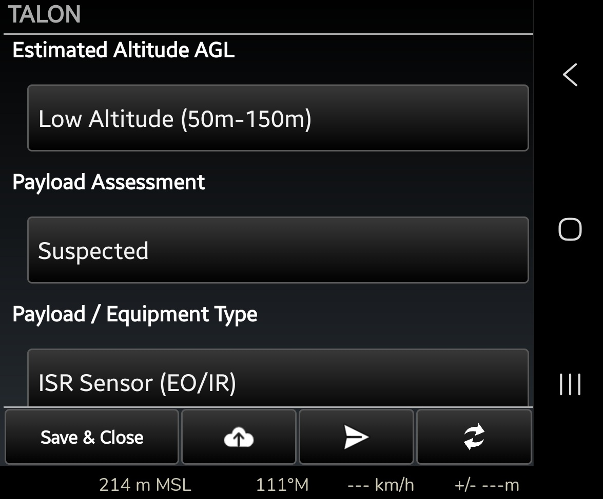
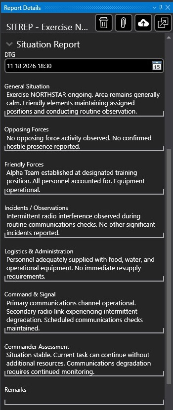
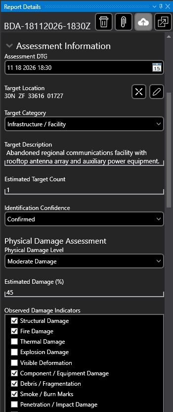
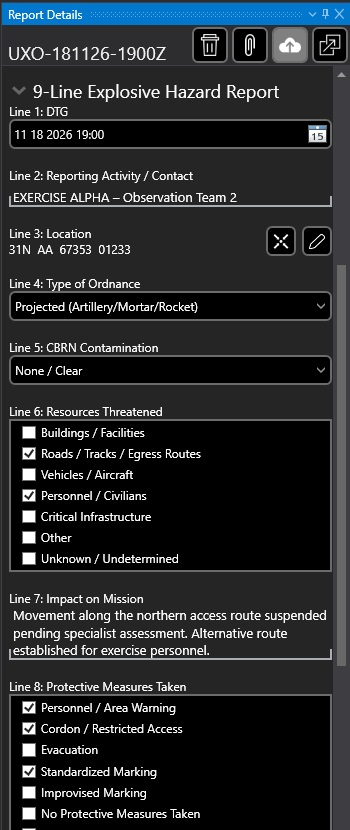

# TAK Reports Templates

A collection of XML-based operational reporting templates for [TAK](https://tak.gov), covering tactical, intelligence, logistics, communications, incident response, and other operational requirements.

Designed for practical field use, with structured reporting fields to capture relevant operational information.

## Platform Support

Separate implementations are provided for ATAK and WinTAK, with platform-specific XML configurations and field adaptations.

| Platform | Version Tested | Implementation |
| :--- | :--- | :--- |
| ATAK | 5.8.0 | Individual XML templates |
| WinTAK | 5.8.0 | Templates organized into five custom categories |

**WinTAK Categories**

| Category | Templates |
| :--- | :--- |
| OPS | SITREP, SALUTE, CONTACTREP |
| INTEL | INTREP, BDAREP, TALON |
| SIGNALS | LINKREP, COMREP |
| LOG | LOGREP, INFRAREP, ROUTEREP |
| HAZMAT | METHANE, CBRNREP, UXO / IED |

Both implementations follow consistent reporting structures and information requirements, while accommodating differences in platform capabilities.

## Included Templates

| Template | Description |
| :--- | :--- |
| **SITREP** | Situation report covering operational status, unit readiness, and mission progress. |
| **SALUTE** | Standard observation report (Size, Activity, Location, Unit, Time, Equipment). |
| **INTREP** | Intelligence reporting, including observations, collection information, analytical assessments, and Admiralty Code ratings. |
| **LINKREP** | Tactical communications link status, covering affected nodes, transport media, connectivity, signal quality, and operational impact. |
| **LOGREP** | Logistics reporting covering personnel, supplies, equipment readiness, and structured resupply requests with up to five line items. |
| **UXO / IED** | Explosive hazard reporting based on the 9-Line format. |
| **TALON** | C-UAS reporting covering UAS characteristics, activity, location, control links, altitude, payload, and other observations. |
| **COMREP** | Communications observations, including frequencies, signal characteristics, direction of arrival, interference, and suspected or confirmed jamming. |
| **METHANE** | Major incident reporting covering incident identification, hazards, access, emergency services, resources, and MASCAL casualty counts. |
| **CBRNREP** | CBRN incident reporting, including hazard detection, agent identification, contamination, exposure, and protective measures. |
| **CONTACTREP** | Enemy or threat contact reporting, including location, strength, observed activity, actions taken, and outcome. |
| **BDAREP** | Battle damage assessment covering physical damage, functional status, affected capabilities, collateral effects, and assessment confidence. |
| **INFRAREP** | Infrastructure status, including operational condition, utilities, accessibility, hazards, capacity, and support requirements. |
| **ROUTEREP** | Route assessment covering condition, accessibility, trafficability, restrictions, obstacles, and environmental hazards. |

## Screenshots

### ATAK 5.8.0

Examples of the templates running in ATAK.

| INTREP - Intelligence Report | LOGREP - Logistics Report |
| :---: | :---: |
|  |  |
| Structured reporting and collection information | Custom measurement units |

| ROUTEREP - Route Assessment | TALON - C-UAS Report |
| :---: | :---: |
|  |  |
| Multi-select categories | Altitude and payload assessment |

### WinTAK 5.8.0

Examples of the templates running in WinTAK.

| SITREP | BDAREP |
| :---: | :---: |
|  |  |
| Situation report | Battle damage assessment |

| COMREP | UXO / IED |
| :---: | :---: |
|  |  |
| Communications report | 9-Line UXO report |

## Installation

These templates require the `Reports` plugin.

### ATAK

1. Ensure the Reports plugin is installed and enabled.
2. Create the following directory if it does not exist:

   ```text
   /sdcard/atak/tools/reports/templates/custom/
   ```

3. Copy the ATAK `.xml` files into the `custom` directory.
4. Open the Reports plugin and select the desired template.

### WinTAK

1. Ensure the Reports plugin is installed and enabled.
2. Copy the WinTAK category XML files into:

   ```text
   %APPDATA%\WinTAK\Surveillance\Templates\
   ```

3. Restart WinTAK.
4. Open the Reports interface and verify that the five custom categories are displayed.

**Note:** ATAK and WinTAK use different XML structures and platform-specific field configurations. Their templates are not directly interchangeable.

## Custom Templates

See [**CUSTOM-TEMPLATE-GUIDE.md**](examples/CUSTOM-TEMPLATE-GUIDE.md) for separate ATAK and WinTAK examples covering field types, sections, selection controls, geospatial inputs, measurement units, and platform-specific configurations.

Custom templates should be tested in their intended platform and version.

## Testing and Compatibility

All templates have been loaded and tested in their respective supported versions.

Testing covers:

- Template loading and display.
- Field rendering and interaction.
- Selection controls and multi-select functionality.
- Geospatial inputs and map interaction, where supported.
- Numeric inputs and measurement units.
- Report submission, export, and sharing.
- WinTAK category persistence after application restart.

XML well-formedness alone does not establish runtime compatibility.

## Contributing

1. Fork the repository.
2. Create a feature branch.
3. Ensure XML files are well-formed and special characters are escaped.
4. Test changes in the intended platform and version.
5. Submit a Pull Request.

## License

Distributed under the [MIT License](LICENSE).
