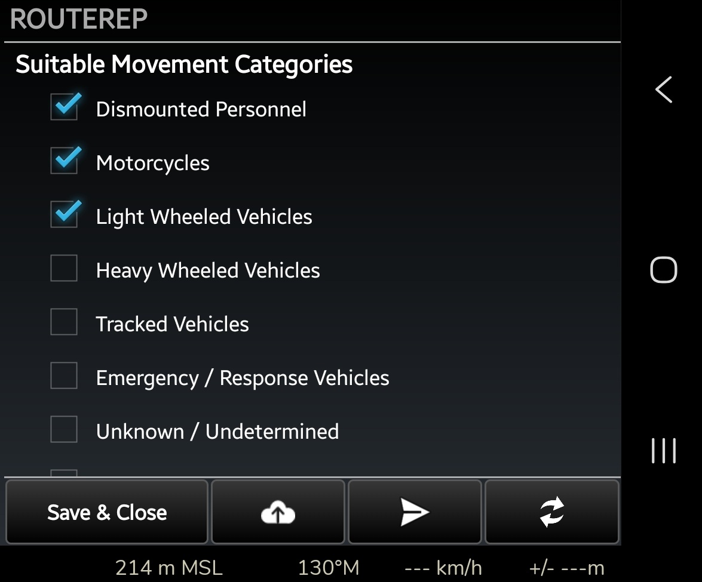
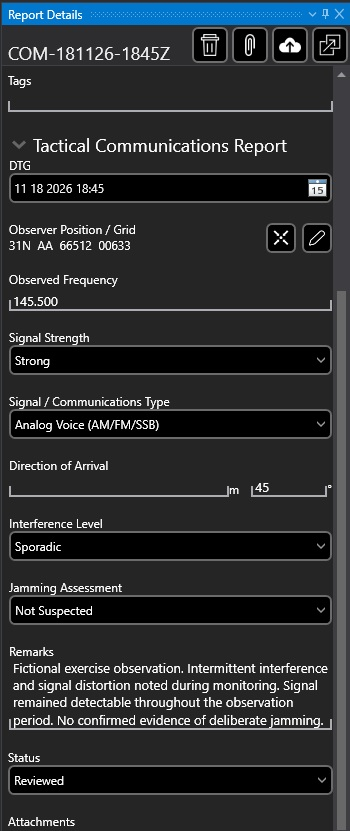

# TAK Reports Templates

A collection of XML-based operational reporting templates for [TAK](https://tak.gov), covering established reporting formats and purpose-built templates for tactical, intelligence, logistics, communications, incident response, and other operational requirements.

Designed to be simple enough for field use, yet comprehensive enough to capture information that matters.

## Platform Support

This repository provides reporting templates for both ATAK and WinTAK. Separate platform implementations accommodate differences in XML configuration, supported field types, and application-specific capabilities.

| Platform | Version Tested | Implementation |
| :--- | :--- | :--- |
| ATAK | 5.8.0 | Individual XML templates. |
| WinTAK | 5.8.0 | Templates organized into dedicated operational categories. |

Both implementations follow a common reporting structure and are designed to preserve consistent information requirements, section organisation, and reporting functionality across platforms. Platform-specific adaptations are applied where differences in supported fields and application behavior require them.

### WinTAK Categories

WinTAK templates are organized into five operational categories:

| Category | Included Templates |
| :--- | :--- |
| OPS | SITREP, SALUTE, CONTACTREP |
| INTEL | INTREP, BDAREP, TALON |
| SIGNALS | LINKREP, COMREP |
| LOG | LOGREP, INFRAREP, ROUTEREP |
| HAZMAT | METHANE, CBRNREP, UXO / IED |

## Included Templates

| Template | Description |
| :--- | :--- |
| **SITREP** | Situation report covering operational status assessment, unit readiness, and mission progress. |
| **SALUTE** | Standard report for tactical field observations (Size, Activity, Location, Unit, Time, Equipment). |
| **INTREP** | Intelligence report for documenting observed activities, target characteristics, collection information, and analytical assessments, including source reliability and information credibility ratings (Admiralty Code). |
| **LINKREP** | Tactical communications link status report covering affected nodes, transport media, network connectivity, signal quality, and operational impact. |
| **LOGREP** | Logistics report covering personnel strength and availability, supply levels, equipment readiness, and resupply requirements. Includes structured supply assessments, request priority and status tracking, delivery location, and up to five individual resupply line items with quantities, units of measurement, and additional specifications. |
| **UXO / IED** | Explosive hazard reporting template based on the 9-Line reporting format. |
| **TALON** | Structured C-UAS reporting template for documenting unmanned aircraft system (UAS) observations, including platform characteristics, observed activity, location, orientation, acoustic signatures, formations, control links, navigation characteristics, altitude, payload assessments, and visual characteristics. |
| **COMREP** | Communications observation report covering observed frequencies, signal strength, signal and communications types, direction of arrival, and interference conditions, including suspected or confirmed jamming. |
| **METHANE** | Major incident report for emergency triage, scene hazard identification, access routing, and mass casualty (MASCAL) counts. |
| **CBRNREP** | CBRN incident reporting, including hazard detection, agent identification confidence, contamination assessment, personnel exposure and protective measures. |
| **CONTACTREP** | Template for reporting enemy or threat contacts, including contact location, target type and strength, observed activity, actions taken by own forces, and contact outcome. |
| **BDAREP** | Battle damage assessment, including physical damage, functional status, affected capabilities, collateral effects and assessment confidence. |
| **INFRAREP** | Infrastructure status reporting, including operational condition, utility availability, accessibility, safety hazards, capacity and support requirements. |
| **ROUTEREP** | Route assessment covering route condition, accessibility, trafficability, movement restrictions, obstacles, and environmental hazards. |

## Key Features

- **Established reporting formats:** Implementations of established reporting formats and conventions, including `SITREP`, `SALUTE`, `INTREP`, `LOGREP`, `METHANE`, and `UXO/IED` (9-line), with appropriate adaptations for ATAK and WinTAK.
- **Purpose-built templates:** Dedicated reporting structures for tactical data link status (`LINKREP`), counter-UAS observations (`TALON`), RF communications observations (`COMREP`), CBRN incidents (`CBRNREP`), contact reporting (`CONTACTREP`), battle damage assessment (`BDAREP`), infrastructure status (`INFRAREP`), and route assessment (`ROUTEREP`).
- **Operational Adaptability:** Reporting structures designed to accommodate different operational environments, evolving technologies, and situational awareness requirements.
- **Multi-Select Fields:** Checkbox-based selections for recording multiple observations, hazards, conditions, and requirements where applicable.
- **Geospatial Integration:** Supports location selection, directional observations, and route definition. ATAK implementations use native `geometry`, `rangeBearing`, and `route` field types where applicable.
- **Cross-Platform Compatibility:** Consistent reporting structures and information requirements across ATAK and WinTAK, with platform-specific XML configurations and field adaptations.
- **Configurable XML Templates:** Lightweight XML-based report definitions that can be adapted to different operational reporting requirements.

## Screenshots

### ATAK 5.8.0

Examples of the reporting templates running in ATAK `5.8.0`.

| INTREP - Intelligence Report | LOGREP - Logistics Report |
| :---: | :---: |
|  |  |
| Structured reporting and collection information | Custom measurement units |

| ROUTEREP - Route Assessment | TALON - C-UAS Report |
| :---: | :---: |
|  |  |
| Multi-select categories | Altitude and payload assessment |

### WinTAK 5.8.0

Examples of the reporting templates running in WinTAK `5.8.0`.

| SITREP | BDAREP |
| :---: | :---: |
|  |  |
| Situation report | Battle damage assessment |

| COMREP | UXO/IED |
| :---: | :---: |
|  |  |
| Communications report | 9-Line UXO report |

## Installation

These templates are designed for use with the `Reports` plugin.

### ATAK

1. Ensure the Reports plugin is installed and enabled.
2. Copy the `.xml` template files to:

```text
/sdcard/atak/tools/reports/templates/custom/
```

3. Create the `custom` directory if it does not exist.
4. Open the Reports plugin and select the desired template.

### WinTAK

1. Ensure the Reports plugin is installed and enabled in WinTAK.
2. Copy the `.xml` template files to:

```text
/AppData/Roaming/WinTAK/Surveillance/Templates/
```
3. Restart WinTAK to load the updated configuration.
4. Open the Reports interface and verify that the five categories (`OPS`, `INTEL`, `SIGNALS`, `LOG`, and `HAZMAT`) are displayed with their associated templates.

WinTAK and ATAK use platform-specific report definitions. Their XML files are not directly interchangeable.

## Building Custom Templates

The repository includes [**`CUSTOM-TEMPLATE-GUIDE.md`**](examples/CUSTOM-TEMPLATE-GUIDE.md), a reference guide containing separate custom report template examples for ATAK and WinTAK.

Each example demonstrates the XML structure, field types and configurations used by its respective platform.

The examples cover:

- **Text and input fields:** String, numeric, time and date-time inputs.
- **Required and optional fields:** Field configuration and input requirements.
- **Sections and organisation:** Grouping related fields into report sections, including nested sections in the ATAK implementation.
- **Selection fields:** Dropdown lists, radio buttons, standalone checkboxes and multi-select options.
- **Geospatial fields:** Location geometry, range and bearing, and route selection.
- **Measurement fields:** Numeric inputs with configurable measurement units.
- **Formula fields:** Example formula field configuration in the ATAK implementation.

Use the relevant platform example as a starting point when creating or adapting reporting templates. Modify the report metadata, section structure, field definitions and identifiers to suit your reporting requirements.

ATAK and WinTAK use platform-specific XML structures and field configurations. Their templates are not directly interchangeable. Custom templates should be tested in their intended platform and version to verify field rendering and functionality.

## Usage

### ATAK

1. Open ATAK.
2. Launch the Reports plugin.
3. Select the desired reporting template.
4. Complete the relevant fields.
5. Submit or share the report through the available reporting workflow.

### WinTAK

1. Open WinTAK.
2. Open the Reports interface.
3. Select the desired report from its operational category.
4. Complete the relevant fields.
5. Submit or share the report through the available WinTAK reporting workflow.

## Testing and Compatibility

All ATAK templates have been loaded and tested in ATAK `5.8.0`.

WinTAK report definitions have been loaded and tested in WinTAK `5.8.0`, including their custom category organization.

Testing includes:

- Template loading and display.
- Field rendering and interaction.
- Dropdown and multi-select functionality.
- Geospatial field selection and map interaction, where supported.
- Numeric inputs and measurement units, where applicable.
- Nested sections and repeated report structures, where supported by the platform.
- Report submission.
- Report export and sharing.
- WinTAK category persistence after application restart.

XML well-formedness checks alone do not establish runtime compatibility.

## Contributing

1. Fork the repository.
2. Create a feature branch (`git checkout -b feature/new-template`).
3. Ensure XML files are well-formed and special characters are properly escaped.
4. Test changes in the intended platform and version (ATAK or WinTAK).
5. Submit a Pull Request.

## License

Distributed under the [MIT License](LICENSE).
